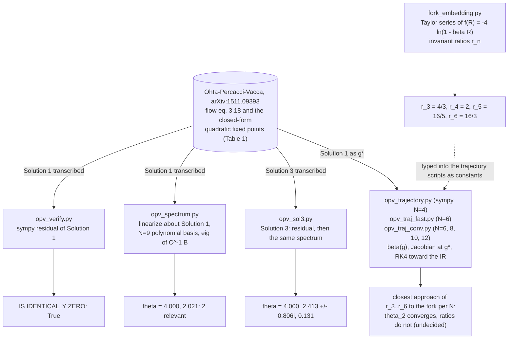
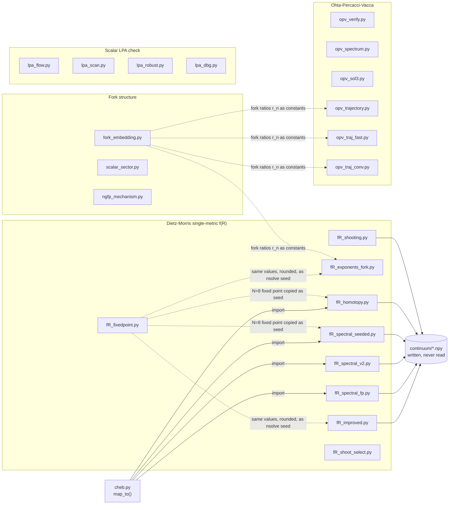
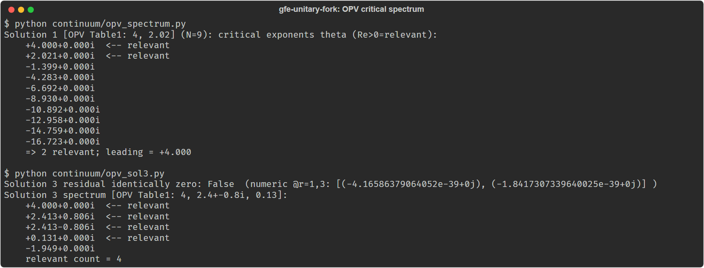

# Gravity from Entropy - the unitary fork (computation code)

Computation code accompanying the preprint **_A Ghost-Free, Unitary, Starobinsky-Class
Realization of Gravity from Entropy_** (Cristian Ruvalcaba and the Saluca Agentic AI Research
Team, 2026), for readers who want to rerun or audit the asymptotic-safety and f(R) computations
behind it.

The paper constructs an explicit scalar-field (Fisher-metric) realization of Ginestra Bianconi's
_Gravity from Entropy_ program and shows it is ghost-free (three ways), unitary (at the
field-theory and operator-emergence levels, with the non-perturbative KMS-vs-bath question
settled), and observationally viable (Starobinsky inflation + thawing dark energy). This
repository holds the symbolic and numerical computations behind those claims - **including the
attempts that failed.**

> Preprint + full archive (PDF, LaTeX source, this code): Zenodo, concept DOI
> [`10.5281/zenodo.21361405`](https://doi.org/10.5281/zenodo.21361405) (resolves to the latest
> version).

## How it works

The path that produced the critical spectrum, as the scripts run it. Every box is a script in
`continuum/` (or the paper its closed forms were transcribed from); every arrow is what the
script computes or prints. Nothing is passed between scripts at run time: each one carries its
own copy of the inputs.



Every number in the output boxes is printed by the script that points at it; see
[Reproduce a result](#reproduce-a-result) for the commands.

## Status

Research artifact, archived with the preprint (all commits dated 2026-07-14). Not a maintained
library: each script in `continuum/` is a standalone computation that prints its result.

> **Correction, 2026-10-22:** this README's "Honest status" section (below) said the fork's
> critical spectrum was **not** obtained and that five attempts had failed. That was written
> before the later commits of 2026-07-14. The per-script guide
> [`continuum/README.md`](continuum/README.md) records that seven single-metric methods failed and
> that the critical spectrum was then **obtained** with the Ohta-Percacci-Vacca exponential
> parametrization (`opv_verify.py`, `opv_spectrum.py`, `opv_sol3.py`), validated against OPV
> Table 1. What remains open is narrower: the RG trajectory from that fixed point to the fork's
> exact IR coupling ratios, which the truncation study (`opv_traj_conv.py`) found undecided. The
> table and the "Honest status" text below are kept as published, with this note as the
> correction. This README also said the DOI would resolve "once the record is published"; the
> record is published (2026-07-14), and the citation now uses the concept DOI rather than the
> version DOI.

### What's here (as published)

All scripts are in [`continuum/`](continuum/) with a per-script guide in
[`continuum/README.md`](continuum/README.md). Python 3.12 (`numpy`, `sympy`, `scipy`, `mpmath`).
On Windows set `PYTHONIOENCODING=utf-8`. Run from the repository root.

| area | scripts | status |
|---|---|---|
| Fork in RG theory space (radius of convergence = R_max, one-parameter ray, UV asymptotics) | `fork_embedding.py` | self-derived, clean |
| Scalar-sector UV analysis (disformal & k-essence irrelevant ⇒ UV-benign) | `scalar_sector.py` | clean |
| Asymptotic-safety mechanism | `ngfp_mechanism.py` | schematic, exact-in-toy |
| Chebyshev spectral instrument | `cheb.py` | **validated to machine precision** |
| f(R) non-Gaussian fixed point (exact Dietz-Morris equation) | `fR_fixedpoint.py`, `fR_improved.py`, `fR_spectral_seeded.py` | **reproduced: g\*λ\* ≈ 0.09-0.1, in the CPR band, confirmed four independent ways** |
| Critical spectrum / trajectory | `fR_exponents_fork.py`, `fR_spectral_fp.py`, `fR_spectral_v2.py` | **open** - see below (superseded: see the correction above) |

### Honest status (as published; see the correction above)

The f(R) non-Gaussian fixed point is **reproduced and robustly confirmed**. The fork's _exact_
critical spectrum and RG trajectory are **not** obtained here: five principled numerical attempts
each failed for a well-understood reason (small-propagator-denominator instability in polynomial
truncations; a singular boundary-value problem that naive Newton / least-squares cannot converge
without parameter continuation), and a verified search found **no turn-key public code** for the
f(R) fixed-point spectrum - the field runs private Mathematica. That computation is well-posed
but externally gated; it is the honest open edge stated in §8 of the paper. **No fixed point,
exponent, or trajectory was ever fabricated to close a gap.**

## Install

Tested 2026-10-22 on Python 3.12.10 with numpy 2.4.6, scipy 1.17.1, sympy 1.14.0, mpmath 1.3.0.
There is no package to install; clone and install the four dependencies:

```bash
git clone https://github.com/saluca-labs/gfe-unitary-fork
cd gfe-unitary-fork
python -m pip install numpy scipy sympy mpmath
```

On Windows set `PYTHONIOENCODING=utf-8` first (the scripts print Unicode).

## Quickstart

From the repository root, the critical spectrum around OPV Solution 1 (about 8 seconds on a
desktop CPU):

```bash
python continuum/opv_spectrum.py
```

Output from a run on 2026-10-22:

```
Solution 1 [OPV Table1: 4, 2.02] (N=9): critical exponents theta (Re>0=relevant):
    +4.000+0.000i  <-- relevant
    +2.021+0.000i  <-- relevant
    -1.399+0.000i
    -4.283+0.000i
    -6.692+0.000i
    -8.930+0.000i
    -10.892+0.000i
    -12.958+0.000i
    -14.759+0.000i
    -16.723+0.000i
    => 2 relevant; leading = +4.000
```

## Usage

Each script runs with no arguments from the repository root. Measured on 2026-10-22:

| command | result | time |
|---|---|---|
| `python continuum/cheb.py` | derivative error 4.62e-14; eigenvalues 1, 4, 9, 16, 25, 36; PASS | under 1 s |
| `python continuum/fork_embedding.py` | invariant ratios r_4 = 2, r_5 = 16/5, r_6 = 16/3; UV asymptotics discussion | about 1 s |
| `python continuum/opv_verify.py` | Solution 1 residual simplifies to 0 (symbolic and numeric) | about 1 s |
| `python continuum/opv_spectrum.py` | Solution 1 exponents 4.000, 2.021 (2 relevant) | about 8 s |
| `python continuum/opv_sol3.py` | Solution 3 exponents 4.000, 2.413 ± 0.806i, 0.131; symbolic simplification reports `False`, numeric residual about 1e-39 | about 8 s |
| `python continuum/fR_fixedpoint.py` | not completed: stopped after a 5 minute limit in the 2026-10-22 check | over 5 min |

The trajectory scripts (`opv_traj_fast.py`, `opv_traj_conv.py`, `opv_trajectory.py`) and the
failed-attempt solvers (`fR_*`, `lpa_*`) were not rerun in the 2026-10-22 check. Their recorded
outcomes are in [`continuum/README.md`](continuum/README.md).

## Architecture

Flat: every file in `continuum/` is an independent script, except `cheb.py`, which is the
Chebyshev differentiation instrument the spectral solvers import. The scripts fall into four
groups:

- **Fork structure:** `fork_embedding.py`, `scalar_sector.py`, `ngfp_mechanism.py`.
- **Dietz-Morris single-metric f(R) flow (fixed point reproduced, spectrum attempts failed):**
  `fR_fixedpoint.py`, `fR_improved.py`, `fR_exponents_fork.py`, `fR_spectral_fp.py`,
  `fR_spectral_v2.py`, `fR_spectral_seeded.py`, `fR_homotopy.py`, `fR_shooting.py`,
  `fR_shoot_select.py`.
- **Ohta-Percacci-Vacca exponential parametrization (spectrum obtained):** `opv_verify.py`,
  `opv_spectrum.py`, `opv_sol3.py`, then the trajectory tests `opv_trajectory.py`,
  `opv_traj_fast.py`, `opv_traj_conv.py`.
- **Machinery check on the scalar LPA (Wilson-Fisher):** `lpa_flow.py`, `lpa_scan.py`,
  `lpa_robust.py`, `lpa_dbg.py`.

The only run-time link between scripts is the `cheb.map_to` import. Everything else that looks
like a dependency is a value typed into one script's source from another script's earlier
output, and the `.npy` files some solvers save are read by no script and are not committed:



Solid arrows are run-time imports or file writes; dotted arrows are values copied into the
source by hand. Only `fR_spectral_seeded.py` (line 11) names its source, `fR_fixedpoint.py` at
N=8; `fR_homotopy.py` carries the identical nine coefficients, and `fR_improved.py` and
`fR_exponents_fork.py` carry the same values rounded, without a source comment, so those three
edges are inferred from the values.
The OPV scripts each carry their own transcription of the OPV equation and fixed points.

### In this repository and not in it

| part of the paper | in this repo | where it lives |
|---|---|---|
| Fork's place in RG theory space, scalar-sector power counting, AS mechanism toy | yes | `continuum/fork_embedding.py`, `scalar_sector.py`, `ngfp_mechanism.py` (MIT) |
| f(R) fixed point, critical spectrum, trajectory tests, failed attempts | yes | `continuum/fR_*.py`, `opv_*.py`, `lpa_*.py`, `cheb.py` (MIT) |
| Ghost-freedom tensor algebra (det G = 3βc/8 > 0) | no | done in Cadabra2; result stated in the preprint |
| Starobinsky n_s, thawing dark energy | no | done in hi_class; result stated in the preprint |
| Preprint text, PDF, LaTeX source | no | Zenodo, concept DOI [10.5281/zenodo.21361405](https://doi.org/10.5281/zenodo.21361405) (CC-BY-4.0) |

The symbolic tensor algebra and cosmology in the paper (ghost-freedom, Starobinsky n_s, thawing
dark energy) were done separately in Cadabra2 and hi_class and are not in this repository.

### Reproduce a result

Each result the README states, the script that re-derives it (no data files are involved: every
input is in the script's source), and the record it backs, the preprint at concept DOI
[10.5281/zenodo.21361405](https://doi.org/10.5281/zenodo.21361405).

| result | command | what to look for |
|---|---|---|
| Fork invariant ratios r_3..r_6 = 4/3, 2, 16/5, 16/3 | `python continuum/fork_embedding.py` | the `r_3 =` to `r_6 =` lines |
| Chebyshev instrument validated | `python continuum/cheb.py` | `=> PASS` |
| OPV Solution 1 is an exact fixed point | `python continuum/opv_verify.py` | `IS IDENTICALLY ZERO: True` |
| Solution 1 spectrum 4.000, 2.021, two relevant | `python continuum/opv_spectrum.py` | `=> 2 relevant; leading = +4.000` |
| Solution 3 spectrum 4.000, 2.413 ± 0.806i, 0.131 | `python continuum/opv_sol3.py` | the first four exponents |
| theta_2 converges, trajectory ratios do not | `python continuum/opv_traj_conv.py` | the N = 6, 8, 10, 12 table (not rerun on 2026-10-22) |
| f(R) fixed point g\*λ\* in the CPR band | `python continuum/fR_fixedpoint.py` | the g\*λ\* line (over 5 minutes; not completed on 2026-10-22) |

## Screenshots



Captured 2026-10-22 from a clean clone; the commands and the captured text are in
[`docs/img/opv-critical-spectrum-2026-10-22.txt`](docs/img/opv-critical-spectrum-2026-10-22.txt).

## Citation

Cite the preprint by its Zenodo concept DOI,
[10.5281/zenodo.21361405](https://doi.org/10.5281/zenodo.21361405), which always resolves to the
latest version. [`CITATION.cff`](CITATION.cff) carries the same DOI, so GitHub's "Cite this
repository" button gives the right reference.

## Provenance / AI transparency

This work was produced by a human-directed agentic large-language-model research system under
continuous human validation, with a human author solely accountable for every claim. The
apparatus repeatedly caught and retracted its own overreach (hallucinated arXiv identifiers,
incorrect critical exponents) before it could stand; the failed attempts are archived here by
design. No claim should be treated as established solely because an AI produced it.

## License

Everything in this repository is code or repository docs, under **MIT** (see [`LICENSE`](LICENSE)),
declared in [`REUSE.toml`](REUSE.toml) ([REUSE](https://reuse.software) layout). The paper, its
figures and its LaTeX source are not in this repository: they are archived on Zenodo under
CC-BY-4.0 (see the Zenodo record).

## Links

- Preprint and archive: https://doi.org/10.5281/zenodo.21361405
- Per-script guide and dated updates: [`continuum/README.md`](continuum/README.md)
- Ohta, Percacci, Vacca, exponential parametrization: arXiv:1511.09393
- Dietz, Morris, f(R) fixed functions: arXiv:1211.0955

_Last updated: 2026-10-22_
